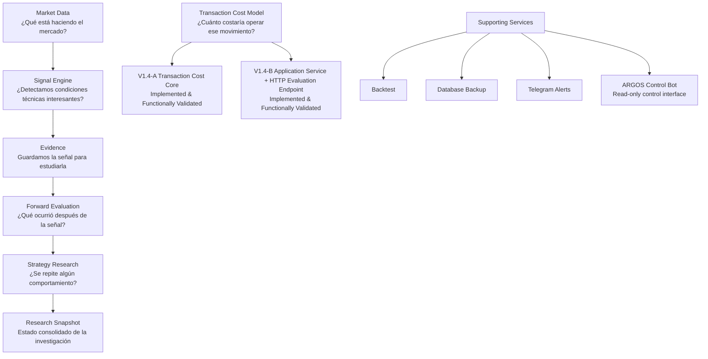
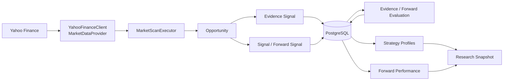
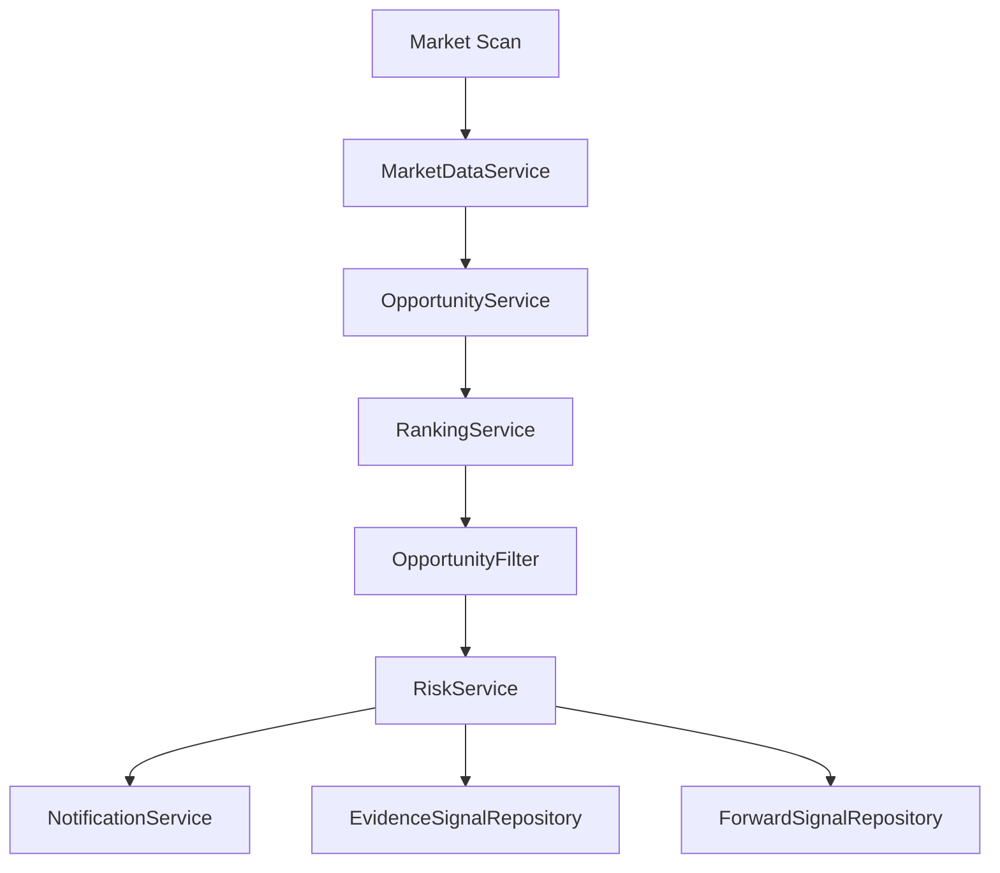
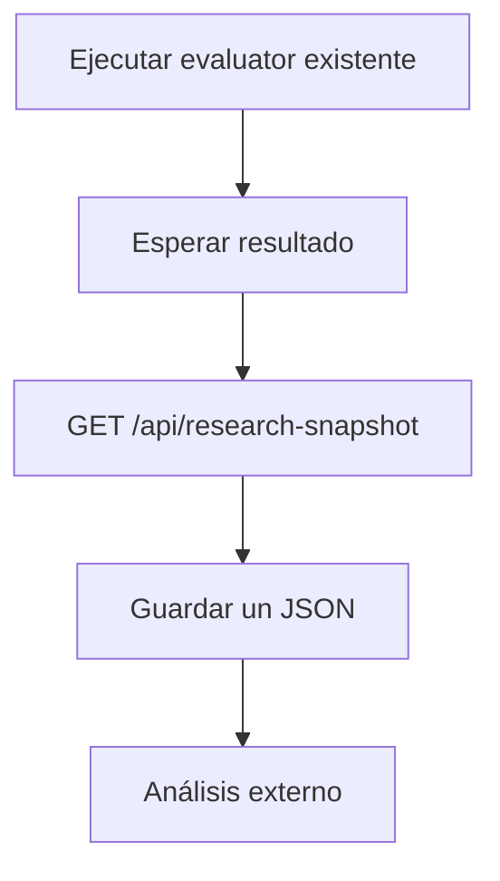
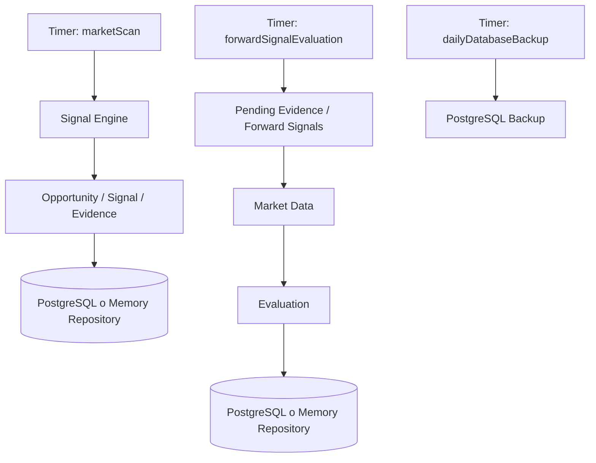
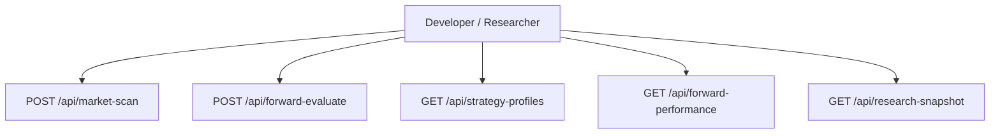

# ARGOS — Functional Architecture

ARGOS es un sistema experimental de soporte a decisiones de mercado. Su función principal es observar datos de mercado, detectar condiciones técnicas, guardar evidencia y permitir investigación posterior.

Este documento explica cómo funciona ARGOS hoy. No describe una promesa futura como si ya estuviera implementada.

## Relación con otros documentos

- [README.md](../README.md): introducción técnica y ejecución del proyecto.
- [ROADMAP.md](./ROADMAP.md): qué estamos construyendo y qué viene después.
- [bitacora_experimental.md](./reports/bitacora_experimental.md): evidencia experimental observada durante la investigación.
- `ARCHITECTURE.md`: cómo funciona ARGOS y cómo se relacionan sus capas principales.

## Glosario mínimo

- **Pipeline**: secuencia de pasos por los que pasa la información dentro del sistema.
- **Signal / señal**: evento detectado por el motor cuando el mercado cumple ciertas condiciones técnicas.
- **Evidence / evidencia**: señal guardada para estudiar después qué ocurrió. Evidence no significa ganancia.
- **Score**: puntaje técnico de 0 a 100 que resume tendencia, volumen, momentum y estructura.
- **Target**: movimiento de precio que queremos evaluar como objetivo.
- **Break-even**: movimiento mínimo necesario para cubrir los costos modelados.
- **Backtest**: simulación con datos históricos para observar qué habría ocurrido en el pasado.
- **Forward Evaluation**: evaluación de qué ocurrió realmente después de una señal registrada.
- **MFE**: Maximum Favorable Excursion; mayor movimiento que alcanzó el precio a favor de la señal.
- **MAE**: Maximum Adverse Excursion; mayor movimiento que alcanzó el precio en contra de la señal.
- **WIN**: el precio alcanzó el objetivo evaluado antes de invalidarse.
- **LOSS**: el precio alcanzó el nivel de pérdida antes del objetivo evaluado.
- **EXPIRED**: la ventana de evaluación terminó sin resolver el objetivo.
- **AMBIGUOUS**: una vela tocó objetivo y stop dentro del mismo periodo, por lo que no se sabe cuál ocurrió primero.
- **Maker**: ejecución que aporta una orden al libro y espera que alguien la tome.
- **Taker**: ejecución que toma una orden existente para ejecutarse inmediatamente.
- **Fee**: comisión cobrada por el broker o exchange.
- **Round Trip Cost**: costo total de comprar + vender.

## Diagrama principal



## Data Flow actual



Notas importantes del flujo:

- El proveedor actual de datos de mercado es `YahooFinanceClient`.
- `YahooFinanceClient` implementa `MarketDataProvider` y entrega velas normalizadas.
- Una **vela** representa un periodo de mercado con precio de apertura, máximo, mínimo, cierre y volumen.
- PostgreSQL es la fuente única de verdad para configuración funcional y universo de mercado. Los repositorios en memoria quedan reservados para pruebas unitarias aisladas; el runtime operativo no usa fallback ENV para reglas del motor.
- `Research Snapshot` no ejecuta evaluadores ni escaneos; sólo consolida información existente.

## Market Data

Market Data significa información cruda o normalizada del mercado: precios, volumen y tiempo.

Implementación actual:

- Cliente actual: `YahooFinanceClient`.
- Puerto: `MarketDataProvider`.
- Servicio consumidor: `MarketDataService`.

Quién consume Market Data:

- `MarketScanExecutor`, para detectar oportunidades nuevas.
- `AnalyzeSymbolService`, para análisis ad-hoc desde el Control Bot sin persistir resultados.
- `EvidenceSignalEvaluator`, para revisar qué ocurrió después de Evidence guardada.
- `ForwardSignalEvaluator`, para revisar qué ocurrió después de señales reales notificables.
- `BacktestEngine`, para simular escenarios históricos.

## Signal Engine

Signal Engine es la capa que detecta condiciones técnicas interesantes.

Analiza cuatro dimensiones:

- Tendencia: dirección general del precio.
- Volumen: actividad de compra/venta comparada con su promedio.
- Momentum: fuerza reciente del movimiento.
- Estructura: patrones como rupturas o máximos/mínimos crecientes.

El score es un puntaje de 0 a 100. No significa “comprar”. Significa que, según las reglas actuales, el setup cumple más o menos condiciones técnicas.

Functions relacionadas:

- `marketScan`: timerTrigger automático.
- `marketScanHttp`: `GET,POST /api/market-scan` para ejecución manual o bajo demanda.

Flujo simplificado:



Cuando encuentra una señal, puede:

- registrarla como Opportunity;
- guardarla como Evidence para investigación;
- guardarla como Forward Signal;
- enviarla por Telegram si supera el threshold configurado.

## Evidence

Evidence dentro de ARGOS significa: “observamos una señal real y la guardamos para estudiarla después”.

No significa:

- que el trade sea rentable;
- que deba comprarse el activo;
- que el score sea una recomendación;
- que la oportunidad haya superado costos reales de ejecución.

Información persistida de Evidence:

- ticker;
- provider symbol;
- timeframe;
- fecha de detección;
- timestamp de la candle que originó la señal (`signal_candle_timestamp`);
- tipo de señal;
- score total y scores parciales;
- razones técnicas;
- entry;
- stops y targets;
- strategy version;
- metadata como asset type, sector, industry y market cuando existe.

Tablas relacionadas:

- `evidence_signals`
- `evidence_signal_evaluations`
- `evidence_target_evaluations`

Identidad de señal:

```text
ticker + timeframe + signal_candle_timestamp + strategy_version + signal_type
```

PostgreSQL protege `signals` y `evidence_signals` con índices únicos parciales sobre esa identidad
cuando `signal_candle_timestamp IS NOT NULL`. Los registros legacy con `NULL` permanecen intactos y
no se reescriben automáticamente.

### Raw Evidence vs Research Eligible Evidence

ARGOS conserva dos lecturas distintas de Evidence:

- **Raw Evidence**: todo lo que el motor registró históricamente. Se conserva como bitácora/auditoría y no se borra aunque después se detecte que una señal fue duplicada.
- **Research Eligible Evidence**: subconjunto que puede participar en métricas de investigación como Strategy Profiles, Research Snapshot, Forward Performance, winRate, reachRate, MFE, MAE y sampleSize.

La columna `excluded_from_research` no es un soft-delete global. Solo significa que esa Evidence no debe alimentar métricas de investigación. Las consultas raw, debugging y auditoría pueden seguir viendo esos registros.

La reparación histórica de duplicados conserva los registros originales, marca duplicados de alta confianza con su `canonical_evidence_signal_id` y deja posibles duplicados como `review_required=true` sin excluirlos automáticamente. No hace backfill de `signal_candle_timestamp`.

## Forward Evaluation

Forward Evaluation significa observar qué ocurrió después de una señal real previamente registrada.

Functions relacionadas:

- `forwardSignalEvaluation`: timerTrigger automático.
- `forwardEvaluateHttp`: `POST /api/forward-evaluate` para ejecución manual.

Diferencia:

```text
Automático:
Timer -> busca señales pendientes -> consulta Market Data -> actualiza evaluaciones

Manual:
POST /api/forward-evaluate -> ejecuta evaluación bajo demanda
```

El código actual ejecuta tanto `ForwardSignalEvaluator` como `EvidenceSignalEvaluator` en el timer. El endpoint manual también puede disparar evaluación forward y/o evidence según su request.

Resultados posibles:

- `OPEN`: todavía no se resolvió.
- `PARTIALLY_RESOLVED`: una parte se resolvió y otra sigue pendiente.
- `CLOSED`: la evaluación terminó con resultado cerrado.
- `EXPIRED`: se acabó la ventana de evaluación.
- `AMBIGUOUS`: hubo una vela donde se tocaron niveles relevantes y el orden no es claro.

## Strategy Research

Strategy Research busca patrones descriptivos dentro de la evidencia acumulada.

No significa todavía que una estrategia sea rentable o lista para operar con dinero real.

Endpoints:

- `GET /api/strategy-profiles`
- `GET /api/forward-performance`

`strategy-profiles` responde preguntas como:

> ¿Qué perfiles de señales existen por tipo de activo, temporalidad, bucket de score y versión de estrategia?

Agrupaciones actuales:

- `assetType`: tipo de instrumento, por ejemplo acción, ETF o cripto.
- `timeframe`: temporalidad de la vela, por ejemplo `1m`, `15m`, `1d`.
- `scoreBucket`: rango de score, por ejemplo `90-94`.
- `strategyVersion`: versión de reglas del motor, por ejemplo `v1`.

`forward-performance` responde preguntas agregadas como:

> ¿Cómo se comportaron las señales evaluadas por ticker, sector, industry, timeframe, score bucket o asset type?

Incluye métricas como:

- sample size;
- win rates;
- MFE / MAE;
- performance por timeframe;
- performance por ticker;
- performance por sector e industry;
- historical forward expectancy;
- profit factor.

## Research Snapshot

`GET /api/research-snapshot` funciona como una fotografía consolidada del estado actual de investigación.

Según el código actual, consolida:

- metadata del snapshot;
- data quality de Evidence vs Evaluations;
- resumen de Evidence por score bucket;
- oportunidades operacionales usando `OPPORTUNITY_MIN_SCORE`;
- distribución de estados de evaluación;
- profile sample sizes;
- Global Target Ladder;
- MFE / MAE by profile;
- Strategy Profiles usando `PostgresStrategyProfileProvider`;
- Watch Profiles derivados desde Strategy Profiles;
- Forward Performance usando `PostgresForwardPerformanceProvider`.

Es read-only:

- no ejecuta Market Scan;
- no ejecuta evaluadores;
- no crea Evidence;
- no modifica PostgreSQL;
- no escribe archivos;
- no interpreta resultados.

Workflow recomendado:



## Transaction Cost Model

Market Evidence responde:

> ¿Qué hizo el mercado?

Transaction Cost Model responde:

> ¿Cuánto costaría económicamente aprovechar ese movimiento?

Principio clave:

```text
Market movement is not the same as investor return.
El movimiento del mercado no es lo mismo que el rendimiento de tu dinero.
```

Conceptos:

- **Gross**: resultado antes de costos.
- **Net**: resultado después de los costos modelados.
- **Fee**: comisión.
- **Round Trip Cost**: costo total de comprar + vender.
- **Break-even**: movimiento mínimo necesario para cubrir los costos modelados.

Estado actual:

```text
V1.4-A — Transaction Cost Core
Status: IMPLEMENTED & FUNCTIONALLY VALIDATED
```

Actualmente existe como core aislado:

- `TransactionCostCalculator`
- `BrokerProductProfileCatalog`
- perfiles `BITSO_CRYPTO_MXN` y `BITSO_CRYPTO_USDC`

V1.4-B agrega una capa de aplicación y endpoint HTTP read-only:

```text
POST /api/transaction-costs/evaluate
Status: IMPLEMENTED & FUNCTIONALLY VALIDATED
```

El endpoint usa `TransactionCostService`, resuelve el perfil de broker/producto y delega el cálculo al core V1.4-A. No escribe en PostgreSQL, no llama Yahoo, no envía Telegram y no crea órdenes.

## Supporting Services

Estos componentes apoyan ARGOS, pero no son una etapa directa del pipeline principal de investigación.

### Backtest

Endpoint:

```text
POST /api/backtest
```

Backtest significa usar información histórica para simular qué habría ocurrido si la lógica hubiese existido en ese momento.

Diferencia clave:

```text
BACKTEST
mira hacia el pasado:
¿Qué habría ocurrido?

FORWARD EVALUATION
parte de una señal registrada:
¿Qué ocurrió después?
```

### Database Backup

Functions:

```text
POST /api/database-backup
dailyDatabaseBackup timerTrigger
```

`databaseBackup` ejecuta un backup manual bajo demanda.

`dailyDatabaseBackup` ejecuta backup automático con el schedule configurado.

Su objetivo es proteger la información de PostgreSQL, no analizar mercado.

### Telegram Alerts + Control Core

Function actual de alertas/prueba:

```text
GET,POST /api/telegram-test
```

`telegramTest` envía un mensaje de prueba usando `NotificationService`.

Telegram en ARGOS está separado conceptualmente en:

- **Alerts Channel**: operativo; envía notificaciones automáticas mediante `NotificationService` y `TelegramClient`.
- **Control Core**: implementado y validado internamente; todavía no tiene transporte Telegram real.

```text
                         ARGOS
                           |
              +------------+------------+
              |                         |
              v                         v
        ALERTS CHANNEL             CONTROL CORE
              |                         |
    NotificationService        Authorization
              |                         |
      TelegramClient           Command Router
              |                         |
        Telegram API              Presenter
                                        |
                              Conversation State
                                        |
                                        X
                              Telegram Transport
                              NOT IMPLEMENTED YET
```

Control Core actual:

```text
TelegramControlUpdate
        ↓
Authorization
        ↓
Command Router
        ↓
Presenter
        ↓
ControlResponse
```

Este flujo puede probarse internamente mediante unit tests y, desde V1.5-B, también mediante updates reales de Telegram recibidos por Long Polling local.

Componentes reales de V1.5-A/V1.5-B:

- `TelegramControl` models: update interno, response e inline keyboard models.
- `TelegramAuthorizationService`: autorización por Telegram `user_id`.
- `TelegramCommandRouter`: enruta comandos y callbacks.
- `TelegramControlPresenter`: construye textos, menús, errores y placeholders.
- `TelegramConversationStateService`: estado en memoria con TTL de 15 minutos.
- `TelegramControlClient`: cliente dedicado para Telegram Bot API usando `fetch` nativo.
- `TelegramControlUpdateMapper`: convierte raw Telegram JSON a `TelegramControlUpdate`.
- `TelegramControlPollingService`: coordina Long Polling, autorización previa al router, offset en memoria, backoff y shutdown.
- `telegramControlWorker`: proceso Node persistente para correr Control Bot fuera de Azure Functions.

Telegram es una interfaz, no una capa de lógica de negocio. Desde V1.5-C, las primeras consultas read-only se conectan así:

```text
Telegram Control
   ↓
TelegramCommandRouter
   ↓
TelegramControlReadOnlyQueryService
   ↓
ResearchSnapshotService / StrategyProfileProvider / ForwardPerformanceProvider / System Status
   ↓
PostgreSQL
   ↓
TelegramControlPresenter
```

El router no llama endpoints HTTP locales. HTTP Functions y Telegram son adapters que reutilizan servicios/providers de aplicación.

Desde V1.5-D, Transaction Costs queda conectado al modelo real de V1.4 mediante un flujo conversacional read-only:

```text
TelegramCommandRouter
        ↓
TelegramConversationStateService
        ↓
TransactionCostService
        ↓
TransactionCostCalculator
        ↓
TelegramControlPresenter
```

Telegram recoge perfil, capital, target y tipo de ejecución. No duplica fórmulas de fees, utilidad neta, break-even ni round-trip cost. Maker aplica entrada y salida Maker; Taker aplica entrada y salida Taker para mantener una UX simple. Las integraciones read-only de Research Snapshot, Strategy Profiles, Forward Performance y System Status existen desde V1.5-C. Desde V1.5-E, Analyze Symbol también está conectado como análisis técnico ad-hoc read-only. Market Scan desde Telegram sigue pendiente.

#### Callback routing

Convención:

```text
argos:v1:<domain>:<action>
```

Ejemplos:

```text
argos:v1:research:snapshot
argos:v1:market:scan
argos:v1:costs:bitso_mxn
argos:v1:system:status
```

- **Inline Keyboard**: botones mostrados dentro de un mensaje de Telegram.
- **callback_data**: identificador pequeño asociado al botón; no debe contener secretos, JSON grande ni estado sensible.
- **Callback Query**: evento que Telegram produce cuando el usuario presiona un botón.

Desde V1.5-B el worker de Control Bot puede recibir esos callbacks reales desde Telegram y responderlos con mensajes/inline keyboards. Desde V1.5-D, `argos:v1:costs:bitso_mxn` y `argos:v1:costs:bitso_usdc` inician un cálculo conversacional real de costos. Desde V1.5-E, `argos:v1:market:analyze` inicia Analyze Symbol. Desde V1.5-F, `argos:v1:market:scan` muestra confirmación y `argos:v1:market:scan_confirm` ejecuta el Market Scan operacional real.

#### Authorization

Control Bot authorization is based on Telegram `user_id`.

- `user_id`: identifica una cuenta/usuario de Telegram.
- `chat_id`: identifica una conversación/chat.

ARGOS Control utiliza `user_id` para decidir quién puede ejecutar comandos. No se deben documentar IDs reales ni tokens.

#### Conversation state

El estado conversacional actual es en memoria, aislado por `user_id`, con TTL default de 15 minutos. Desde V1.5-D se usa para el flujo de Transaction Costs: perfil → capital → target → Maker/Taker. No usa PostgreSQL y se pierde al reiniciar el worker; esto es intencional. Persistencia podría reconsiderarse para flujos futuros como Trade Companion.

#### Long Polling vs Webhook

Decisión arquitectónica implementada en V1.5-B:

- **Local**: Long Polling Worker. ARGOS consulta a Telegram buscando nuevos updates mediante `getUpdates` con timeout largo.
- **Cloud futuro**: Webhook. Telegram llamará a una URL pública de ARGOS cuando exista un update.

Long Polling no se ejecuta como loop infinito dentro de una Azure Function. Corre como proceso Node persistente con `npm run telegram:control`. Antes de iniciar valida `getWebhookInfo`; si existe un webhook activo, se detiene para no mezclar transportes.

El offset de Telegram vive en memoria: `nextOffset = max(update_id procesado) + 1`. Si el worker reinicia, Telegram puede reenviar updates pendientes. En V1.5-B se procesan normalmente; no se hace flush silencioso al arranque.

#### Future Trade Companion

Futuro, no implementado en V1.5-A:

```text
signal
  ↓
manual user execution
  ↓
user confirms trade
  ↓
Active Trade
  ↓
monitoring
  ↓
TP / Stop Loss notifications
```

No existe schema, `ActiveTradeService` ni broker execution para esto.

## Function Map

| Function                   | Trigger | Endpoint                               | Layer                        | Responsibility                                                     |
| -------------------------- | ------- | -------------------------------------- | ---------------------------- | ------------------------------------------------------------------ |
| `backtest`                 | HTTP    | `POST /api/backtest`                   | Supporting / Backtest        | Simular comportamiento histórico usando `BacktestEngine`.          |
| `databaseBackup`           | HTTP    | `POST /api/database-backup`            | Supporting / Data Protection | Ejecutar backup manual de PostgreSQL.                              |
| `dailyDatabaseBackup`      | Timer   | —                                      | Supporting / Data Protection | Ejecutar backup automático según schedule.                         |
| `forwardEvaluateHttp`      | HTTP    | `POST /api/forward-evaluate`           | Forward Evaluation           | Ejecutar evaluación manual de señales pendientes.                  |
| `forwardPerformance`       | HTTP    | `GET /api/forward-performance`         | Strategy Research            | Consultar métricas agregadas de Evidence/Forward Performance.      |
| `forwardSignalEvaluation`  | Timer   | —                                      | Forward Evaluation           | Evaluar automáticamente señales forward y evidence pendientes.     |
| `marketScan`               | Timer   | —                                      | Signal Engine                | Ejecutar escaneo automático de mercado.                            |
| `marketScanHttp`           | HTTP    | `GET,POST /api/market-scan`            | Signal Engine                | Ejecutar escaneo manual o bajo demanda.                            |
| `researchSnapshot`         | HTTP    | `GET /api/research-snapshot`           | Research                     | Consolidar el estado actual de investigación en un JSON read-only. |
| `transactionCostsEvaluate` | HTTP    | `POST /api/transaction-costs/evaluate` | Transaction Cost Model       | Evaluar costos transaccionales modelados sin side effects.         |
| `strategyProfiles`         | HTTP    | `GET /api/strategy-profiles`           | Strategy Research            | Consultar perfiles descriptivos por asset/timeframe/score/version. |
| `telegramTest`             | HTTP    | `GET,POST /api/telegram-test`          | Supporting / Telegram        | Enviar mensaje de prueba por Telegram.                             |

## Automatic vs Manual Flows

### Automatic Flow



### Manual / Research Flow



Los endpoints HTTP permiten inspección, pruebas y ejecución bajo demanda cuando corresponde.

## Lectura vs escritura de datos

| Component                       |  Reads PostgreSQL | Writes PostgreSQL | Notes                                                                       |
| ------------------------------- | ----------------: | ----------------: | --------------------------------------------------------------------------- |
| `marketScan` / `marketScanHttp` |                Sí |                Sí | Puede persistir opportunities, signals, forward signals y evidence signals. |
| `forwardSignalEvaluation`       |                Sí |                Sí | Lee señales pendientes y actualiza evaluaciones.                            |
| `forwardEvaluateHttp`           |                Sí |                Sí | Igual que la evaluación automática, pero bajo demanda.                      |
| `strategyProfiles`              |                Sí |                No | Consulta research descriptivo.                                              |
| `forwardPerformance`            |                Sí |                No | Consulta performance agregada.                                              |
| `researchSnapshot`              |                Sí |                No | Consolida datos existentes; read-only.                                      |
| `databaseBackup`                |                Sí |                No | Read-only respecto a PostgreSQL; genera archivos de backup.                 |
| `dailyDatabaseBackup`           |                Sí |                No | Read-only respecto a PostgreSQL; genera archivos de backup.                 |
| `backtest`                      | No necesariamente |                No | Usa Market Data y simula; no persiste resultados en DB.                     |
| `telegramTest`                  |                No |                No | Envía mensaje de prueba.                                                    |

## Separación de responsabilidades

| Capa                   | Responsabilidad                                                                                  |
| ---------------------- | ------------------------------------------------------------------------------------------------ |
| Market Data            | Obtiene información de mercado.                                                                  |
| Signal Engine          | Detecta condiciones técnicas.                                                                    |
| Evidence               | Conserva observaciones reales para estudio.                                                      |
| Forward Evaluation     | Mide qué ocurrió después de una señal.                                                           |
| Strategy Research      | Busca patrones descriptivos en la evidencia acumulada.                                           |
| Research Snapshot      | Consolida resultados de investigación en una sola respuesta.                                     |
| Transaction Cost Model | Interpreta costos económicos de convertir un movimiento en operación.                            |
| Backtest               | Estudia comportamiento histórico.                                                                |
| Database Backup        | Protege información persistida.                                                                  |
| Telegram Alerts        | Comunica alertas o mensajes de prueba.                                                           |
| ARGOS Control Core     | Prepara autorización, routing, presenter y estado para una futura interfaz Telegram interactiva. |

## What ARGOS Is Not

De acuerdo con el código actual, ARGOS:

- no ejecuta automáticamente órdenes en Bitso;
- no compra ni vende activos;
- no es actualmente un trading bot autónomo;
- no debe interpretar un score alto automáticamente como “BUY”;
- no considera una señal ganadora automáticamente como una operación rentable;
- mantiene separada la observación del mercado de la interpretación económica.

## Future Architecture

Current:

```text
Market Research
+
Transaction Cost Model Core
```

Future, según roadmap:

```text
Trade Plan Research
```

Trade Plan significa un plan previo de una posible operación que especificaría aspectos como entrada, objetivo de ganancia y límite de pérdida.

V1.4-B agrega una capa de aplicación y un endpoint HTTP para evaluar costos transaccionales de forma read-only. V1.5-A agrega Control Core, V1.5-B agrega transporte real por Long Polling, V1.5-C conecta consultas read-only de Research Snapshot, Strategy Profiles, Forward Performance y System Status desde Telegram, V1.5-D conecta Transaction Costs, V1.5-E conecta Analyze Symbol y V1.5-F conecta Full Market Scan con confirmación explícita. Market Scan desde Telegram usa el pipeline operacional existente. V1.6-A expande el Market Universe de forma data-only para mejorar cobertura por asset class, sector, industry y session type sin modificar scoring ni research.

### V1.6-A — Market Universe Expansion & Segmentation

El universo de mercado se administra como catálogo persistente en PostgreSQL. `market_symbols.symbol` representa el ticker lógico de ARGOS y `market_symbols.provider_symbol` representa el identificador enviado al proveedor de datos. Esta separación mantiene el engine desacoplado de Yahoo Finance aunque Yahoo sea el proveedor operativo actual.

La expansión V1.6-A agrega símbolos curados en Broad Market ETFs, sector ETFs, semiconductores, rates/bonds, metals, utilities, real estate y líderes adicionales por sector. Es una migración data-only, idempotente y non-destructive: no borra históricos, no modifica señales/evidence y no cambia fórmulas ni thresholds.

El flujo operacional sigue cargando un snapshot de configuración y un snapshot de universo al inicio de cada scan. Las reglas de sesión siguen filtrando combinaciones `market-closed` antes de llamar Yahoo.

## Configuración funcional autoritativa

ARGOS lee thresholds, scoring, trade plan, estrategia, límites de velas, throughput de market data y temporalidades notificables desde `market_signal_engine.engine_config`.

El universo de símbolos y timeframes activos se lee desde `market_signal_engine.market_symbols` y `market_signal_engine.symbol_timeframes`.

`local.settings.json` queda limitado a secretos, bootstrap local e infraestructura de Azure Functions. Si PostgreSQL no está disponible, la configuración está incompleta o un símbolo solicitado no existe en el universo activo, ARGOS falla con un error explícito en lugar de usar defaults de ENV.

## ORB-FVG Scalping Research

ORB-FVG es un dominio paralelo de research, aislado de Strategy v1.

La variante activa es `experiment_version=orb-fvg-v0.3` y cambia la semántica clave del experimento:

```text
Breakout + FVG
  ↓
setup de interés
  ↓
NO trade automático
```

v0.3 implementa una máquina de estados prospectiva LONG-only:

```text
WAITING_FOR_OR
  ↓
OR_READY
  ↓
WAITING_FOR_BREAKOUT
  ↓
BREAKOUT_CONFIRMED
  ↓
WAITING_FOR_FVG
  ↓
FVG_CREATED
  ↓
WAITING_FOR_RETEST
  ↓
FVG_RETESTED
  ↓
WAITING_FOR_STRUCTURE_BREAK
  ↓
PRE_RETRACE_HIGH_BROKEN
  ↓
SETUP_PREVIEW
  ↓
WAITING_FOR_CONTINUATION
  ↓
CONTINUATION_CONFIRMED
  ↓
TRADE_READY
```

Implementación actual persistida:

```text
orbFvgScanner timer
  ↓
MarketUniverseService
  ↓
MarketDataService / Yahoo Finance
  ↓
Opening Range 15m
  ↓
LONG Breakout 5m
  ↓
bullish FVG 5m
  ↓
FVG retest
  ↓
close above pre-retrace high
  ↓
SETUP_PREVIEW
  ↓
next candle continuation
  ↓
TRADE_READY
```

Reglas v0.3:

- Opening Range: primera vela 15m 09:30-09:45 ET.
- Breakout LONG: `candle.close > ORHigh AND candle.open <= ORHigh`.
- Bullish FVG: `candle3.low > candle1.high`.
- Retest: una vela posterior intersecta la zona `[fvgLow, fvgHigh]`.
- `preRetraceHigh`: máximo high observado prospectivamente desde la vela que crea el FVG hasta antes del primer retest. No usa swing detection retrospectivo.
- Structure break: una vela posterior al retest cierra arriba de `preRetraceHigh`; esto persiste `SETUP_PREVIEW`.
- Continuation: la siguiente vela completada cierra arriba de `preRetraceHigh` y arriba del cierre de la vela de structure break; esto persiste `TRADE_READY`.
- Multiple retests: se permiten y se cuentan mientras no exista `TRADE_READY` ni expire la sesión; no reinician `preRetraceHigh`.
- Expiration: si termina la regular session antes de `TRADE_READY`, el setup pasa a `EXPIRED_SETUP`.

`SETUP_PREVIEW` significa que ARGOS encontró una estructura avanzada que merece revisión visual. `TRADE_READY` significa que la estructura completa cumple la hipótesis experimental. Ninguno significa recomendación, orden automática ni ejecución broker.

Importante: v0.3 no inventa `entry`, `stop`, `risk` ni `target2R`. Esos campos pueden permanecer `NULL` para setups v0.3 hasta que exista una entrada manual/paper trade metodológicamente definida. `setupPreviewPrice` usa el close de la vela que rompe `preRetraceHigh`; `tradeReadyPrice` usa el close de la vela de confirmación. Son precios de referencia para research, no Entry. Por lo mismo, el forward monitor de WIN/LOSS no evalúa setups v0.3 sin modelo de trade.

La historia se preserva:

- `orb-fvg-v0.1`: histórico; Opening Range 15m + detector automático 1m.
- `orb-fvg-v0.2`: histórico; Opening Range 15m + detector automático 5m con entry en `candle3.close`.
- `orb-fvg-v0.3`: activo; Opening Range 15m + 5m breakout/FVG + retest + structure confirmation.

Todas comparten `market_signal_engine.orb_fvg_signals` y `market_signal_engine.orb_fvg_signal_levels`, separadas por `experiment_version`.

El endpoint `GET /api/orb-fvg/signals` es read-only y sirve para auditoría de setups, estados, niveles R legacy y outcomes históricos. Por defecto consulta la versión activa v0.3; `experimentVersion=orb-fvg-v0.1` o `orb-fvg-v0.2` permite revisar históricos.

Telegram behavior: ORB-FVG usa `ORB_FVG_TRADE_READY_ALERTS_ENABLED`. El default
es `false`, por lo que scanner y persistencia siguen activos pero Telegram queda
silencioso. Si se habilita, sólo se envían alertas para `SETUP_PREVIEW` y `TRADE_READY`, una vez por transición; los estados preliminares (`OR_READY`, `BREAKOUT_CONFIRMED`,
`FVG_CREATED`, `FVG_RETESTED`) permanecen observables
en logs/DB pero no alertan. Strategy v1 Telegram y Shadow Paper Trading no cambian.

v0.3 es prospectivo: cada ejecución procesa la última vela 5m completada y sólo avanza el estado con información disponible hasta ese momento. No recorre toda la sesión buscando retrospectivamente la mejor combinación breakout/FVG/retest/continuation.
