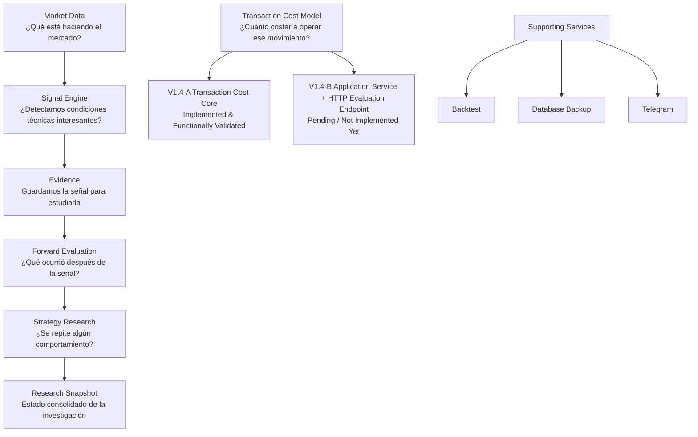
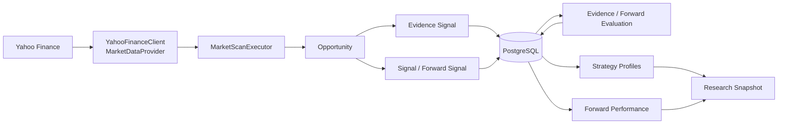
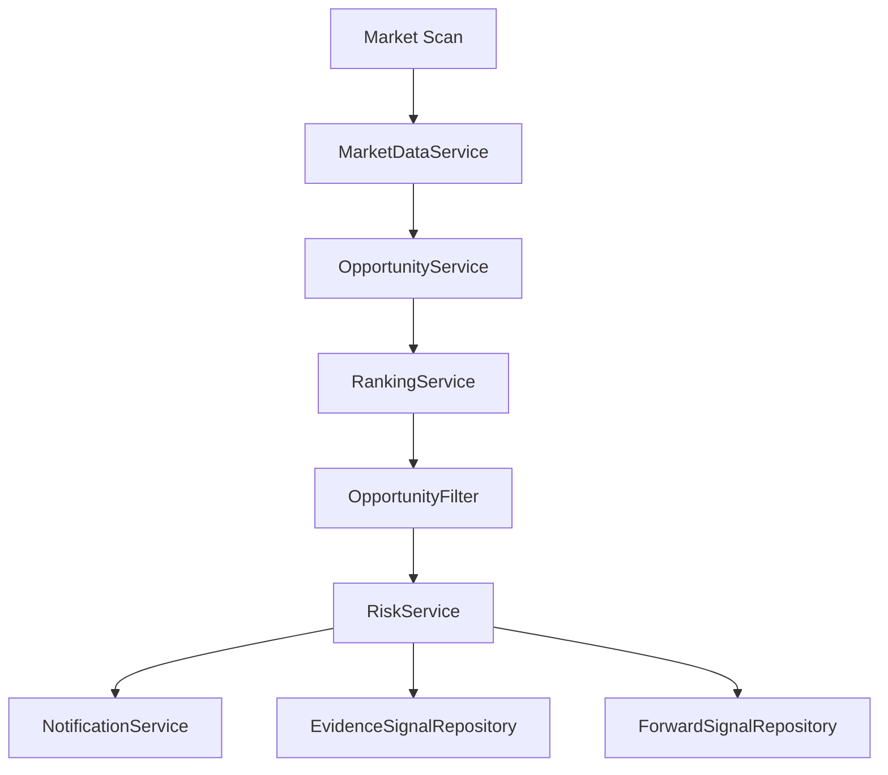
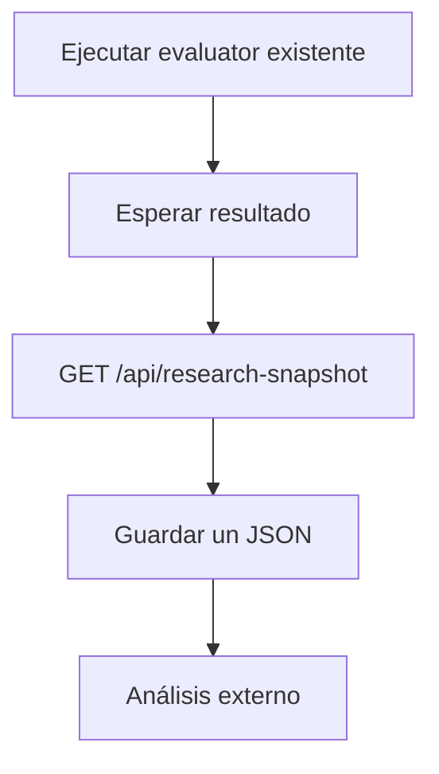
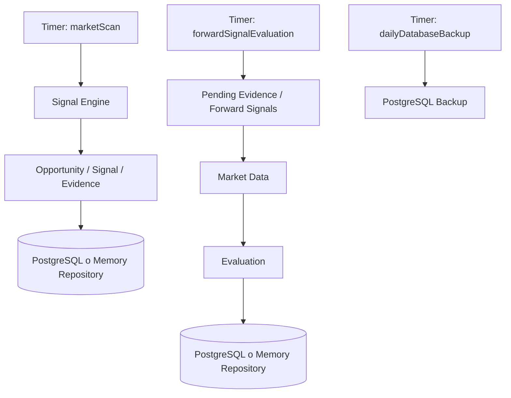
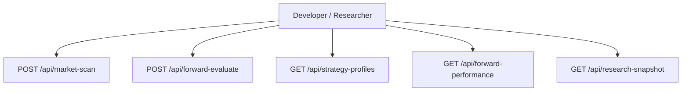

# ARGOS — Functional Architecture

ARGOS es un sistema experimental de soporte a decisiones de mercado. Su función principal es observar datos de mercado, detectar condiciones técnicas, guardar evidencia y permitir investigación posterior.

Este documento explica cómo funciona ARGOS hoy. No describe una promesa futura como si ya estuviera implementada.

## Relación con otros documentos

- [README.md](../README.md): introducción técnica y ejecución del proyecto.
- [ROADMAP.md](./ROADMAP.md): qué estamos construyendo y qué viene después.
- [bitacora_experimental.md](./reports/bitacora_experimental.md): evidencia experimental observada durante la investigación.
- `ARCHITECTURE.md`: cómo funciona ARGOS y cómo se relacionan sus capas principales.

## Glosario mínimo

- **Pipeline**: secuencia de pasos por los que pasa la información dentro del sistema.
- **Signal / señal**: evento detectado por el motor cuando el mercado cumple ciertas condiciones técnicas.
- **Evidence / evidencia**: señal guardada para estudiar después qué ocurrió. Evidence no significa ganancia.
- **Score**: puntaje técnico de 0 a 100 que resume tendencia, volumen, momentum y estructura.
- **Target**: movimiento de precio que queremos evaluar como objetivo.
- **Break-even**: movimiento mínimo necesario para cubrir los costos modelados.
- **Backtest**: simulación con datos históricos para observar qué habría ocurrido en el pasado.
- **Forward Evaluation**: evaluación de qué ocurrió realmente después de una señal registrada.
- **MFE**: Maximum Favorable Excursion; mayor movimiento que alcanzó el precio a favor de la señal.
- **MAE**: Maximum Adverse Excursion; mayor movimiento que alcanzó el precio en contra de la señal.
- **WIN**: el precio alcanzó el objetivo evaluado antes de invalidarse.
- **LOSS**: el precio alcanzó el nivel de pérdida antes del objetivo evaluado.
- **EXPIRED**: la ventana de evaluación terminó sin resolver el objetivo.
- **AMBIGUOUS**: una vela tocó objetivo y stop dentro del mismo periodo, por lo que no se sabe cuál ocurrió primero.
- **Maker**: ejecución que aporta una orden al libro y espera que alguien la tome.
- **Taker**: ejecución que toma una orden existente para ejecutarse inmediatamente.
- **Fee**: comisión cobrada por el broker o exchange.
- **Round Trip Cost**: costo total de comprar + vender.

## Diagrama principal



## Data Flow actual



Notas importantes del flujo:

- El proveedor actual de datos de mercado es `YahooFinanceClient`.
- `YahooFinanceClient` implementa `MarketDataProvider` y entrega velas normalizadas.
- Una **vela** representa un periodo de mercado con precio de apertura, máximo, mínimo, cierre y volumen.
- PostgreSQL se usa cuando `DATABASE_URL` está configurado. Si no, varias piezas usan repositorios en memoria.
- `Research Snapshot` no ejecuta evaluadores ni escaneos; sólo consolida información existente.

## Market Data

Market Data significa información cruda o normalizada del mercado: precios, volumen y tiempo.

Implementación actual:

- Cliente actual: `YahooFinanceClient`.
- Puerto: `MarketDataProvider`.
- Servicio consumidor: `MarketDataService`.

Quién consume Market Data:

- `MarketScanExecutor`, para detectar oportunidades nuevas.
- `EvidenceSignalEvaluator`, para revisar qué ocurrió después de Evidence guardada.
- `ForwardSignalEvaluator`, para revisar qué ocurrió después de señales reales notificables.
- `BacktestEngine`, para simular escenarios históricos.

## Signal Engine

Signal Engine es la capa que detecta condiciones técnicas interesantes.

Analiza cuatro dimensiones:

- Tendencia: dirección general del precio.
- Volumen: actividad de compra/venta comparada con su promedio.
- Momentum: fuerza reciente del movimiento.
- Estructura: patrones como rupturas o máximos/mínimos crecientes.

El score es un puntaje de 0 a 100. No significa “comprar”. Significa que, según las reglas actuales, el setup cumple más o menos condiciones técnicas.

Functions relacionadas:

- `marketScan`: timerTrigger automático.
- `marketScanHttp`: `GET,POST /api/market-scan` para ejecución manual o bajo demanda.

Flujo simplificado:



Cuando encuentra una señal, puede:

- registrarla como Opportunity;
- guardarla como Evidence para investigación;
- guardarla como Forward Signal;
- enviarla por Telegram si supera el threshold configurado.

## Evidence

Evidence dentro de ARGOS significa: “observamos una señal real y la guardamos para estudiarla después”.

No significa:

- que el trade sea rentable;
- que deba comprarse el activo;
- que el score sea una recomendación;
- que la oportunidad haya superado costos reales de ejecución.

Información persistida de Evidence:

- ticker;
- provider symbol;
- timeframe;
- fecha de detección;
- tipo de señal;
- score total y scores parciales;
- razones técnicas;
- entry;
- stops y targets;
- strategy version;
- metadata como asset type, sector, industry y market cuando existe.

Tablas relacionadas:

- `evidence_signals`
- `evidence_signal_evaluations`
- `evidence_target_evaluations`

## Forward Evaluation

Forward Evaluation significa observar qué ocurrió después de una señal real previamente registrada.

Functions relacionadas:

- `forwardSignalEvaluation`: timerTrigger automático.
- `forwardEvaluateHttp`: `POST /api/forward-evaluate` para ejecución manual.

Diferencia:

```text
Automático:
Timer -> busca señales pendientes -> consulta Market Data -> actualiza evaluaciones

Manual:
POST /api/forward-evaluate -> ejecuta evaluación bajo demanda
```

El código actual ejecuta tanto `ForwardSignalEvaluator` como `EvidenceSignalEvaluator` en el timer. El endpoint manual también puede disparar evaluación forward y/o evidence según su request.

Resultados posibles:

- `OPEN`: todavía no se resolvió.
- `PARTIALLY_RESOLVED`: una parte se resolvió y otra sigue pendiente.
- `CLOSED`: la evaluación terminó con resultado cerrado.
- `EXPIRED`: se acabó la ventana de evaluación.
- `AMBIGUOUS`: hubo una vela donde se tocaron niveles relevantes y el orden no es claro.

## Strategy Research

Strategy Research busca patrones descriptivos dentro de la evidencia acumulada.

No significa todavía que una estrategia sea rentable o lista para operar con dinero real.

Endpoints:

- `GET /api/strategy-profiles`
- `GET /api/forward-performance`

`strategy-profiles` responde preguntas como:

> ¿Qué perfiles de señales existen por tipo de activo, temporalidad, bucket de score y versión de estrategia?

Agrupaciones actuales:

- `assetType`: tipo de instrumento, por ejemplo acción, ETF o cripto.
- `timeframe`: temporalidad de la vela, por ejemplo `1m`, `15m`, `1d`.
- `scoreBucket`: rango de score, por ejemplo `90-94`.
- `strategyVersion`: versión de reglas del motor, por ejemplo `v1`.

`forward-performance` responde preguntas agregadas como:

> ¿Cómo se comportaron las señales evaluadas por ticker, sector, industry, timeframe, score bucket o asset type?

Incluye métricas como:

- sample size;
- win rates;
- MFE / MAE;
- performance por timeframe;
- performance por ticker;
- performance por sector e industry;
- historical forward expectancy;
- profit factor.

## Research Snapshot

`GET /api/research-snapshot` funciona como una fotografía consolidada del estado actual de investigación.

Según el código actual, consolida:

- metadata del snapshot;
- data quality de Evidence vs Evaluations;
- resumen de Evidence por score bucket;
- oportunidades operacionales usando `OPPORTUNITY_MIN_SCORE`;
- distribución de estados de evaluación;
- profile sample sizes;
- Global Target Ladder;
- MFE / MAE by profile;
- Strategy Profiles usando `PostgresStrategyProfileProvider`;
- Watch Profiles derivados desde Strategy Profiles;
- Forward Performance usando `PostgresForwardPerformanceProvider`.

Es read-only:

- no ejecuta Market Scan;
- no ejecuta evaluadores;
- no crea Evidence;
- no modifica PostgreSQL;
- no escribe archivos;
- no interpreta resultados.

Workflow recomendado:



## Transaction Cost Model

Market Evidence responde:

> ¿Qué hizo el mercado?

Transaction Cost Model responde:

> ¿Cuánto costaría económicamente aprovechar ese movimiento?

Principio clave:

```text
Market movement is not the same as investor return.
El movimiento del mercado no es lo mismo que el rendimiento de tu dinero.
```

Conceptos:

- **Gross**: resultado antes de costos.
- **Net**: resultado después de los costos modelados.
- **Fee**: comisión.
- **Round Trip Cost**: costo total de comprar + vender.
- **Break-even**: movimiento mínimo necesario para cubrir los costos modelados.

Estado actual:

```text
V1.4-A — Transaction Cost Core
Status: IMPLEMENTED & FUNCTIONALLY VALIDATED
```

Actualmente existe como core aislado:

- `TransactionCostCalculator`
- `BrokerProductProfileCatalog`
- perfiles `BITSO_CRYPTO_MXN` y `BITSO_CRYPTO_USDC`

No tiene endpoint HTTP todavía.

Futuro documentado:

```text
POST /api/transaction-costs/evaluate
Status: FUTURE / NOT IMPLEMENTED YET
```

Ese endpoint corresponde a V1.4-B y no existe actualmente en `src/functions`.

## Supporting Services

Estos componentes apoyan ARGOS, pero no son una etapa directa del pipeline principal de investigación.

### Backtest

Endpoint:

```text
POST /api/backtest
```

Backtest significa usar información histórica para simular qué habría ocurrido si la lógica hubiese existido en ese momento.

Diferencia clave:

```text
BACKTEST
mira hacia el pasado:
¿Qué habría ocurrido?

FORWARD EVALUATION
parte de una señal registrada:
¿Qué ocurrió después?
```

### Database Backup

Functions:

```text
POST /api/database-backup
dailyDatabaseBackup timerTrigger
```

`databaseBackup` ejecuta un backup manual bajo demanda.

`dailyDatabaseBackup` ejecuta backup automático con el schedule configurado.

Su objetivo es proteger la información de PostgreSQL, no analizar mercado.

### Telegram

Function:

```text
GET,POST /api/telegram-test
```

`telegramTest` envía un mensaje de prueba usando `NotificationService`.

Telegram en ARGOS es un canal de comunicación/notificación. No ejecuta operaciones, no compra y no vende activos.

## Function Map

| Function | Trigger | Endpoint | Layer | Responsibility |
|---|---|---|---|---|
| `backtest` | HTTP | `POST /api/backtest` | Supporting / Backtest | Simular comportamiento histórico usando `BacktestEngine`. |
| `databaseBackup` | HTTP | `POST /api/database-backup` | Supporting / Data Protection | Ejecutar backup manual de PostgreSQL. |
| `dailyDatabaseBackup` | Timer | — | Supporting / Data Protection | Ejecutar backup automático según schedule. |
| `forwardEvaluateHttp` | HTTP | `POST /api/forward-evaluate` | Forward Evaluation | Ejecutar evaluación manual de señales pendientes. |
| `forwardPerformance` | HTTP | `GET /api/forward-performance` | Strategy Research | Consultar métricas agregadas de Evidence/Forward Performance. |
| `forwardSignalEvaluation` | Timer | — | Forward Evaluation | Evaluar automáticamente señales forward y evidence pendientes. |
| `marketScan` | Timer | — | Signal Engine | Ejecutar escaneo automático de mercado. |
| `marketScanHttp` | HTTP | `GET,POST /api/market-scan` | Signal Engine | Ejecutar escaneo manual o bajo demanda. |
| `researchSnapshot` | HTTP | `GET /api/research-snapshot` | Research | Consolidar el estado actual de investigación en un JSON read-only. |
| `strategyProfiles` | HTTP | `GET /api/strategy-profiles` | Strategy Research | Consultar perfiles descriptivos por asset/timeframe/score/version. |
| `telegramTest` | HTTP | `GET,POST /api/telegram-test` | Supporting / Telegram | Enviar mensaje de prueba por Telegram. |

## Automatic vs Manual Flows

### Automatic Flow



### Manual / Research Flow



Los endpoints HTTP permiten inspección, pruebas y ejecución bajo demanda cuando corresponde.

## Lectura vs escritura de datos

| Component | Reads PostgreSQL | Writes PostgreSQL | Notes |
|---|---:|---:|---|
| `marketScan` / `marketScanHttp` | Sí | Sí | Puede persistir opportunities, signals, forward signals y evidence signals. |
| `forwardSignalEvaluation` | Sí | Sí | Lee señales pendientes y actualiza evaluaciones. |
| `forwardEvaluateHttp` | Sí | Sí | Igual que la evaluación automática, pero bajo demanda. |
| `strategyProfiles` | Sí | No | Consulta research descriptivo. |
| `forwardPerformance` | Sí | No | Consulta performance agregada. |
| `researchSnapshot` | Sí | No | Consolida datos existentes; read-only. |
| `databaseBackup` | Sí | No | Read-only respecto a PostgreSQL; genera archivos de backup. |
| `dailyDatabaseBackup` | Sí | No | Read-only respecto a PostgreSQL; genera archivos de backup. |
| `backtest` | No necesariamente | No | Usa Market Data y simula; no persiste resultados en DB. |
| `telegramTest` | No | No | Envía mensaje de prueba. |

## Separación de responsabilidades

| Capa | Responsabilidad |
|---|---|
| Market Data | Obtiene información de mercado. |
| Signal Engine | Detecta condiciones técnicas. |
| Evidence | Conserva observaciones reales para estudio. |
| Forward Evaluation | Mide qué ocurrió después de una señal. |
| Strategy Research | Busca patrones descriptivos en la evidencia acumulada. |
| Research Snapshot | Consolida resultados de investigación en una sola respuesta. |
| Transaction Cost Model | Interpreta costos económicos de convertir un movimiento en operación. |
| Backtest | Estudia comportamiento histórico. |
| Database Backup | Protege información persistida. |
| Telegram | Comunica alertas o mensajes de prueba. |

## What ARGOS Is Not

De acuerdo con el código actual, ARGOS:

- no ejecuta automáticamente órdenes en Bitso;
- no compra ni vende activos;
- no es actualmente un trading bot autónomo;
- no debe interpretar un score alto automáticamente como “BUY”;
- no considera una señal ganadora automáticamente como una operación rentable;
- mantiene separada la observación del mercado de la interpretación económica.

## Future Architecture

Current:

```text
Market Research
+
Transaction Cost Model Core
```

Future, según roadmap:

```text
Trade Plan Research
```

Trade Plan significa un plan previo de una posible operación que especificaría aspectos como entrada, objetivo de ganancia y límite de pérdida.

V1.4-B podría agregar una capa de aplicación y un endpoint HTTP para evaluar costos transaccionales, pero eso está pendiente y no está implementado todavía.
